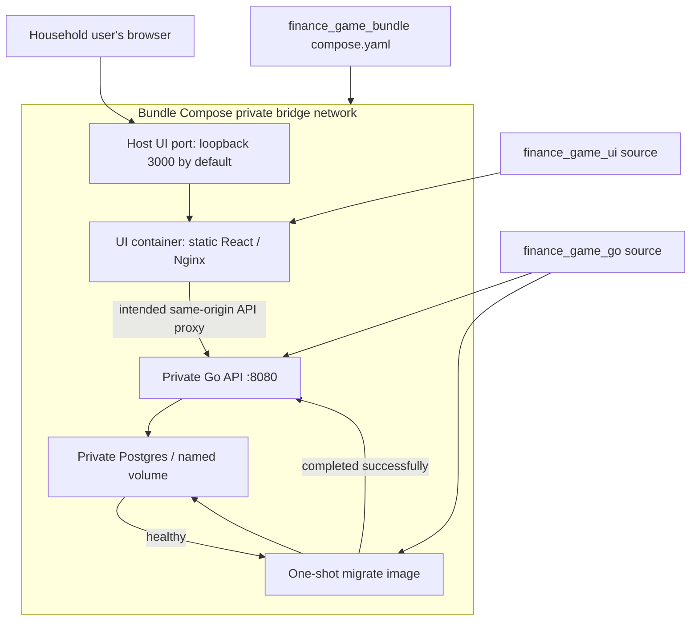
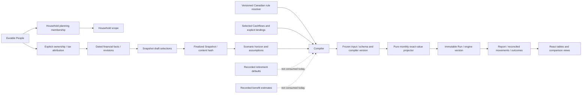
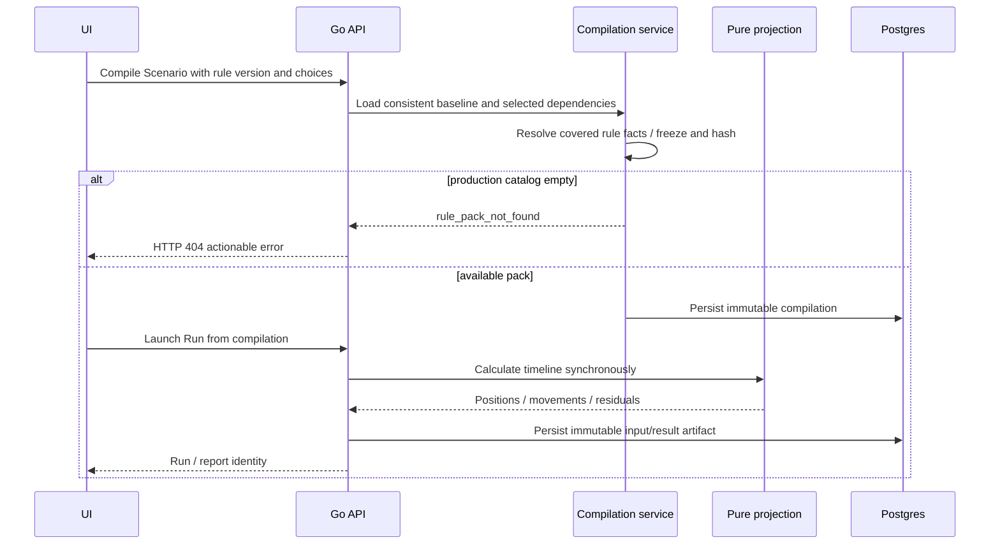
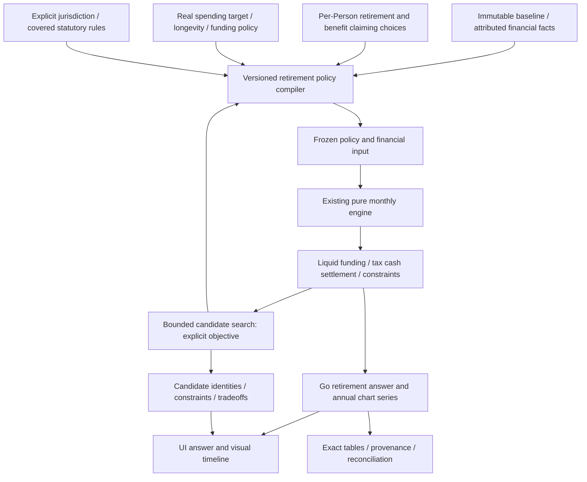
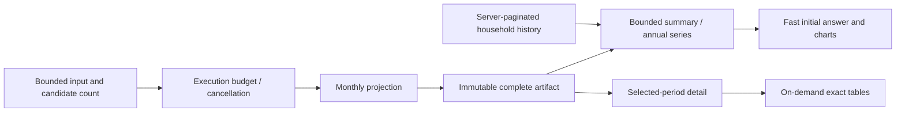
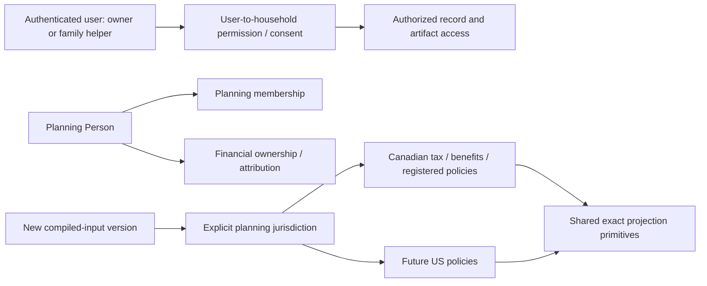

# Finance Game system architecture

Reviewed 2 October 2026. This document covers the assembled app. [Readiness findings](product-readiness-review.md) and [validation evidence](workflow-validation.md) distinguish implementation from proposed extensions. Go and UI source remain in their own repositories.

> **Historical snapshot:** The deployment and capability diagrams reflect the review state on 2 October 2026. The later SLED-86–SLED-88 work changed release qualification and recovery. See [`deployment.md`](deployment.md) and its current release evidence for today's contract.

## Repository and deployment boundaries

This is the configured topology. Its UI edge does **not currently work**: UI Nginx binds loopback using missing variables and points to host-loopback API, while bundle containers require service-name routing and a reachable container listener. Isolated current-source startup reproduced the failure. Only the UI host port is published; do not expose API or Postgres to fix it.

The API checks schema compatibility; migrations do not run inside API startup. Go/API and migration must use the same source revision. UI currently starts after API process startup rather than a full business-capability gate; the UI health command checks static liveness and API readiness. Neither existing check establishes that rule packs can compile a household.

## Implemented domain and artifact flow

Household scope is neither asset ownership nor authorization. Cashflows represent future plans, not bank transactions. A Snapshot freezes selected starting facts; compilation freezes the actual chosen projection dependencies. Editing source facts or Scenario choices must not change an existing input/Run.

The production rule resolver currently contains no packs. The projector supports explicit retirement-related financial events, but stored retirement defaults and benefit estimates do not themselves produce those events.

## Current Run execution and failure recovery

Comparison creates an alternative and executes the two sides sequentially. It may retain partial artifacts on failure; preserve their IDs for recovery. Current comparison compilation does not carry every single-Run option. Current first-period projection also differs from timeline calculation for bound Cashflows. These are defects, not intended architectural invariants.

## Proposed retirement planning extension

This is proposed. Define feasibility before searching: for example, supported spending is funded without negative eligible liquid balances through the chosen horizon, including modeled taxes and benefits. Define what “eligible” means, whether borrowing is allowed and what withdrawal policy applies. Unsupported financial coverage should produce an incomplete answer, not a false successful retirement date.

Retain a pure engine. Add explicit candidate compilation and bounded deterministic grids before a general optimizer. Earliest feasible date and maximum sustainable spending are different objectives. Feasibility may be non-monotonic; do not assume binary search works. Store assumptions, objective, versions and candidate evidence. Future stochastic paths need reproducible seeds and models.

## Performance and result delivery

This delivery split is proposed. Current full artifact/read and eager period DOM behavior are costly at long horizons. Measure engine CPU/allocations, serialization bytes, DB persistence, request deadlines and browser DOM/rendering separately. Existing API WriteTimeout is 15 seconds; comparison runs both sides sequentially. A timeout cannot safely be treated as proof that no artifact was created.

Avoid a distributed queue until benchmarks justify it. If candidate search or actual latency requires jobs, use persistent job identity, idempotent submission, bounded workers, cancellation/status and recoverable completed artifact IDs. Use input content plus rule/engine/objective identities for reproducibility; an input hash alone is not a universal cache key.

## Family access and country policy

These are proposed access/country extensions. Adding a Person never grants access. A helper need not be a planning participant. Check every object/list/report route and revoke permissions without mutating historical financial evidence. Do not add professional practice concepts to meet family delegation.

Today's CA/CAD contracts stay explicit. Future country selection requires schema versions and compatible historic readers, not overloaded province/currency fields. Cross-border tax and FX are separate supported capabilities.

## Release and recovery

Pin a verified UI/API source pair or image digests, together with migration/rule/compiler versions, after a real-stack gate. Default independently moving `#main` contexts cannot identify a reproducible release. Local sibling contexts remain useful for development.

A forward migration is not reversed by rolling back an image. Back up, rehearse restore to a matching database/API pair, verify immutable artifact hashes and record expected downtime. Existing volumes must not be used by review runners. Keep one-shot migration ordering and private network boundaries.

