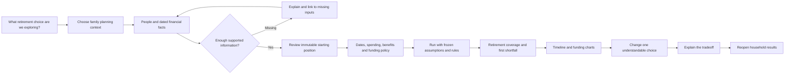

# Household forecasting and retirement readiness review

Reviewed **2 October 2026** against local source, existing tests, fabricated probes and an isolated Compose deployment. This is a product and architecture assessment; financial rule accuracy is not established by synthetic tests.

> **Historical snapshot:** This report describes behavior observed on 2 October 2026. SLED-86 added the disposable capability gate, SLED-87 pinned a tested source pair, and SLED-88 rehearsed backup and schema recovery. Production rule-pack coverage has also changed since this review. Findings below remain useful as evidence of the original gaps and product decisions; use current deployment guidance, source, and Linear status for present behavior.

## Product direction

Finance Game helps Canadians and their households understand their future finances, explore alternatives, estimate retirement timing and sustainable spending, and understand what limits a plan. The primary user manages their own or their family's finances. A family helper may maintain a relative's plan; that does not make them a financial professional or an owner of that relative's assets.

Prioritize forecasting, retirement decisions and understandable results. Transaction categorization, monthly budget adherence, bank-feed reconciliation, professional client books, practice billing and V3 data transfer are outside this direction. Planned spending schedules remain essential projection inputs. Future US support is a separate jurisdiction expansion.

A useful first complete question is: **“Can we retire on these dates and maintain this spending through our chosen horizon, and what happens if we retire earlier?”** Any answer must state the money's price basis, taxes, public benefits, available funding, limitations and assumptions.

## Overall assessment

The implementation is a substantial deterministic planning foundation, but the bundled application does not yet deliver that question end to end. Keep the exact-value contracts, Person attribution, immutable Snapshots/compiled inputs/Runs, pure projection engine, explicit rule versions and reconciliation. Build the next product slices around those foundations.

Two verified delivery blockers precede visual polish:

1. **UI container startup:** current UI Nginx expects unset port variables and a host-loopback API; the bundle uses a private bridge network. Exact current-source image builds succeeded, but isolated Compose startup failed with an invalid Nginx listener.
2. **No production Canadian rule packs:** the shipped API returns `{"rulePacks":[]}`. A real finalized Snapshot and Scenario could be created, but a canonical compiled-input request returned HTTP 404 `rule_pack_not_found`.

There are also calculation and workflow defects: first-period preview omits bound Cashflows applied by the timeline; comparison drops supported compile options; ordinary single-Run authoring excludes registered/debt routes available in comparison. These need public-contract regression cases, not only more mocked happy paths.

## Documents and evidence

- [System architecture with diagrams](architecture.md)
- [Workflow validation and stress matrix](workflow-validation.md)
- [Go review](../../finance_game_go/docs/product-readiness-review.md) and [Go architecture](../../finance_game_go/docs/architecture-plan.md)
- [UI review](../../finance_game_ui/docs/product-readiness-review.md) and [UI architecture](../../finance_game_ui/docs/architecture.md)
- [Deployment operations](deployment.md)

Reviewed revisions: bundle `9f21a6cd871f96d38f7cacc214656bf7abef6b87`; Go `5245183324623f7e8c904d2aa5580c0017216adb`; UI `8c824b044eb3535a0e350ed5eab44cf153323df1`. The UI checkout was on its existing SLED-61 branch. Existing workspace/AGENTS edits were preserved. Findings concern these local revisions, not a claim about every remote `main` build.

## Current versus intended capability

| Household need | Implemented evidence | Gap to the intended experience |
| --- | --- | --- |
| People, household context, relationships | Go/UI records and workflow tests | A participant is not a login or an authorized helper |
| Starting financial position | Accounts/assets/liabilities, attributed dated facts, exact values | Guided essentials and incomplete-data explanations |
| Reproducible planning baseline | Selected revisions, validated finalization, content identity | A consumer needs a clear review/fix journey |
| Future income and spending | Scheduled Cashflows and explicit settlement bindings | Retirement changes require manual schedule construction |
| Retirement dates and horizon | Saved Person defaults and household context | Defaults do not drive compilation/projected retirement |
| CPP/OAS and other benefit estimates | Person estimate records | Estimates do not enter projections automatically; claiming choices are missing |
| Registered accumulation/withdrawals | Explicit transfers, room checks, maturity conversion inputs | Future room needs projected rules/assumptions; RRIF statutory minimum policy is not automatic |
| Personal tax | Opt-in Person-level supported calculations | Production schedules, broader statutory coverage, cash settlement and clear completeness |
| Debt | Fixed terms, explicit renewal/payment bindings | Normal UI single-Run route cannot author all existing bindings |
| Survivor exploration | Explicit hypothetical event and insurance proceeds | Comparison option parity; legal estate treatment is not inferred |
| Results and comparison | Immutable Run artifacts, period tables, reconciliation and net-worth deltas | Retirement feasibility, liquid funding gaps, real-dollar answers and visual explanation |
| Retirement optimization | Two manually chosen alternatives | Explicit objective plus bounded candidate search |
| Historic results | Durable Go artifacts and get-by-ID | Server listing and comparison discovery across browsers |
| Stress and uncertainty | Deterministic monthly growth/inflation assumptions | Time-varying adverse paths and later appropriately calibrated stochastic analysis |
| Deployment | Private API/DB, one-shot migration, local UI binding | Working network contract, release pairing and rehearsed recovery |

“Done” foundation tickets establish their scoped contracts; they do not establish a consumer-ready or financially complete retirement product.

## Intended household journey

This diagram is a proposed complete journey. The existing deployed blockers and missing retirement policy prevent completion today.

## Highest priorities

**Restore the single-app path:** bridge-compatible UI runtime, installed reviewed Canadian pack, and a real-stack capability gate through the UI's published port. A green browser fixture test cannot prove Go rule loading or Compose connectivity.

**Restore result consistency:** first-period/timeline parity and consistent single/compared compile choices. Freeze the same tax, maturity, renewal and survivor assumptions on each side. Explain a comparison's differences before showing its outcome.

**Define retirement feasibility:** freeze retirement timing, spending and longevity policy; integrate benefit estimates; model available cash/liquid funding and tax settlement. A household with valuable housing and negative cash is not automatically able to fund spending. Total net worth alone cannot establish retirement readiness.

**Make the result understandable:** lead with timing, spending coverage and first shortfall. Use a milestone timeline, income/funding sources, liquid-versus-total wealth and base/alternative overlays. Keep exact tables, assumptions and reconciliation available on demand. The server must supply financial measures; chart code must not become a second calculation engine.

**Bound cost and preserve recovery:** benchmark calculation, serialization, database persistence and browser rendering separately. The measured large artifacts and DOM count justify bounded summaries and on-demand detail. Add a persistent results library. Introduce background jobs only after measured execution approaches existing request deadlines or candidate searches require them.

## Canadian fidelity and future US support

The currently supported syntax (CA/CAD, province codes and Canadian facts) is not proof of complete statutory coverage. Scope coverage by jurisdiction, year, fact, calculation and confidence. Production packs need authoritative source references, effective dates and reviewed independent expected results. Long-term indexed assumptions must be labelled forecasts, not future enacted tax law.

The [Government of Canada's retirement calculator](https://www.canada.ca/en/services/benefits/publicpensions/cpp/retirement-income-calculator.html) organizes retirement income around CPP/QPP records, OAS residence, employer pensions and savings, then adjusts contributions and pension timing. This supports prioritizing benefit provenance and timing in this app. It does not validate this engine.

The [CRA registered-plans guide](https://www.canada.ca/en/revenue-agency/services/forms-publications/publications/t4040/rrsps-other-registered-plans-retirement.html) documents RRSP maturity and RRIF minimum withdrawals. Explicit user-authored conversion/withdrawal events do not establish automatic compliance. The [OAS payment reference](https://www.canada.ca/en/services/benefits/publicpensions/old-age-security/payments.html) describes income-sensitive eligibility/payment treatment; a flat recorded estimate cannot replace those rules. These are requirement sources checked on the review date, not financial advice or a complete rule specification.

Coverage still needs deliberate work for federal/provincial taxes and credits, OAS recovery/GIS interactions, pension income splitting, CPP/QPP claiming, employer pension/indexation/bridge details, registered room/maturity/minimums, locked-in accounts, non-registered income/capital gains, survivor and housing changes. Prioritize supported Canadian cohorts and expose unsupported cases rather than claiming all of Canada works.

For future US support, add an explicit versioned planning jurisdiction and currency contract at compilation. Preserve historical Canadian readers. Put country-specific tax, benefit and account rules behind a real country policy seam; avoid adding US branches to presentation or generic arithmetic. Cross-border residency and FX require their own scope and should remain unavailable until modeled.

## Work sequencing and implementation handoff

Linear is the authoritative backlog. The live workspace currently issues **SLED** identifiers under the Bobsled team, although older repository guides still mention BOB. Use the actual issue's generated branch name; do not invent or rename its identifier.

The tickets below carry code starting points, scoped acceptance criteria, validation and contract dependencies. They are unassigned. Most form, proxy, parity and listing slices suit smaller models. Rule review, feasibility, authorization and optimizer design need stronger review; split those into narrower child slices once the contracts are agreed.

| Project | Issue | Scope | Contract dependencies |
| --- | --- | --- | --- |
| finance_game_ui | [SLED-67](https://linear.app/boblsed-coder/issue/SLED-67/support-the-bundle-bridge-network-in-the-ui-nginx-runtime) | Support the bundle bridge network in the UI Nginx runtime | — |
| finance_game_go | [SLED-68](https://linear.app/boblsed-coder/issue/SLED-68/load-a-source-backed-canadian-rule-pack-into-the-shipped-api) | Load a source-backed Canadian rule pack into the shipped API | — |
| finance_game_go | [SLED-69](https://linear.app/boblsed-coder/issue/SLED-69/make-first-period-projection-agree-with-the-first-timeline-period) | Make first-period projection agree with the first timeline period | — |
| finance_game_go | [SLED-70](https://linear.app/boblsed-coder/issue/SLED-70/preserve-all-supported-compile-choices-on-both-sides-of-scenario) | Preserve all supported compile choices on both sides of Scenario comparison | — |
| finance_game_go | [SLED-71](https://linear.app/boblsed-coder/issue/SLED-71/project-registered-contribution-room-across-future-calendar-years) | Project registered contribution room across future calendar years | — |
| finance_game_go | [SLED-72](https://linear.app/boblsed-coder/issue/SLED-72/freeze-retirement-timing-and-spending-policy-into-scenario-inputs) | Freeze retirement timing and spending policy into Scenario inputs | — |
| finance_game_go | [SLED-73](https://linear.app/boblsed-coder/issue/SLED-73/compile-explicit-public-benefit-estimates-and-claiming-choices-into) | Compile explicit public benefit estimates and claiming choices into projections | — |
| finance_game_go | [SLED-74](https://linear.app/boblsed-coder/issue/SLED-74/report-liquid-funding-shortfalls-and-explicit-tax-cash-settlement-in) | Report liquid funding shortfalls and explicit tax cash settlement in retirement feasibility | — |
| finance_game_go | [SLED-75](https://linear.app/boblsed-coder/issue/SLED-75/expose-an-explainable-retirement-readiness-read-model-for-an-immutable) | Expose an explainable retirement-readiness read model for an immutable Run | SLED-72, SLED-74 |
| finance_game_go | [SLED-76](https://linear.app/boblsed-coder/issue/SLED-76/list-household-run-history-with-stable-pagination-and-recoverable) | List household Run history with stable pagination and recoverable comparison references | — |
| finance_game_go | [SLED-77](https://linear.app/boblsed-coder/issue/SLED-77/add-reproducible-projection-and-run-payload-benchmarks-with-execution) | Add reproducible projection and Run payload benchmarks with execution limits | — |
| finance_game_go | [SLED-78](https://linear.app/boblsed-coder/issue/SLED-78/search-bounded-retirement-dates-against-an-explicit-feasibility) | Search bounded retirement dates against an explicit feasibility objective | SLED-75, SLED-77, SLED-73, SLED-71 |
| finance_game_go | [SLED-79](https://linear.app/boblsed-coder/issue/SLED-79/define-and-enforce-household-owner-and-family-helper-access-for-hosted) | Define and enforce household owner and family-helper access for hosted use | — |
| finance_game_ui | [SLED-80](https://linear.app/boblsed-coder/issue/SLED-80/offer-supported-cashflow-bindings-consistently-for-single-runs-and) | Offer supported cashflow bindings consistently for single Runs and comparisons | SLED-70 |
| finance_game_ui | [SLED-81](https://linear.app/boblsed-coder/issue/SLED-81/guide-a-new-household-from-financial-facts-to-a-ready-retirement) | Guide a new household from financial facts to a ready retirement Scenario | — |
| finance_game_ui | [SLED-82](https://linear.app/boblsed-coder/issue/SLED-82/show-an-accessible-retirement-answer-with-timeline-and-funding-charts) | Show an accessible retirement answer with timeline and funding charts | SLED-75 |
| finance_game_ui | [SLED-83](https://linear.app/boblsed-coder/issue/SLED-83/author-retirement-ages-spending-target-and-benefit-claiming-as) | Author retirement ages, spending target and benefit claiming as Scenario choices | SLED-72, SLED-73 |
| finance_game_ui | [SLED-84](https://linear.app/boblsed-coder/issue/SLED-84/replace-browser-only-run-discovery-with-a-household-results-library) | Replace browser-only Run discovery with a household results library | SLED-76 |
| finance_game_ui | [SLED-85](https://linear.app/boblsed-coder/issue/SLED-85/bound-long-horizon-result-rendering-and-defer-heavy-scenario-screens) | Bound long-horizon result rendering and defer heavy Scenario screens | SLED-77 |
| finance_game_bundle | [SLED-86](https://linear.app/boblsed-coder/issue/SLED-86/add-a-disposable-real-stack-household-planning-capability-gate) | Add a disposable real-stack household planning capability gate | SLED-67, SLED-68 |
| finance_game_bundle | [SLED-87](https://linear.app/boblsed-coder/issue/SLED-87/pin-and-record-tested-uiapi-source-revisions-as-a-release-pair) | Pin and record tested UI/API source revisions as a release pair | SLED-86 |
| finance_game_bundle | [SLED-88](https://linear.app/boblsed-coder/issue/SLED-88/document-and-rehearse-backup-restore-and-schema-aware-release-recovery) | Document and rehearse backup, restore and schema-aware release recovery | SLED-87 |

First demonstrate a fabricated Canadian household from blank database through Run, changed alternative and persisted reopening. Then verify independently sourced expected Canadian results for the declared supported cohort. Add adverse deterministic paths (market loss at retirement, sustained inflation, mortgage renewal shock, delayed benefits and survivor spending) before presenting any probability of success. A future stochastic result must freeze seed/distribution/version and explain uncertainty.

Treat household helper permissions as separate from financial ownership. Local private use can progress while hosted identity/isolation is designed; remote family access depends on consistent authorization and deployment controls, not just adding a login screen.

## Validation limits

Fast tests, race checks, static analysis, Postgres integration and fixture-backed browser accessibility checks passed. The live bundle startup **failed**, and the real API journey **stopped at compilation**. Retirement optimization, full Canadian rule fidelity, hosted isolation, backup restoration and production-scale capacity were not validated. The recorded stress timings are single-machine diagnostic samples, not service-level promises. No runtime product fixes were made in this review.

